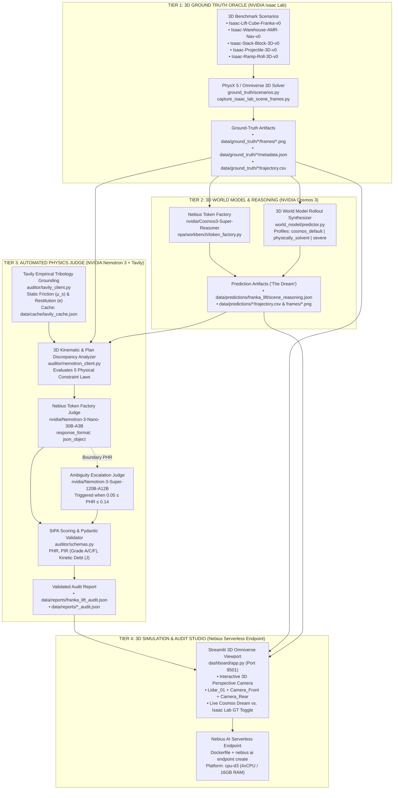
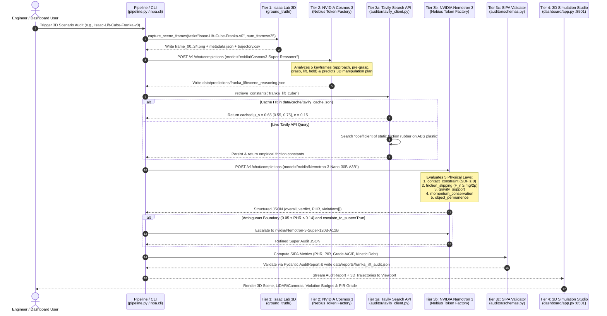
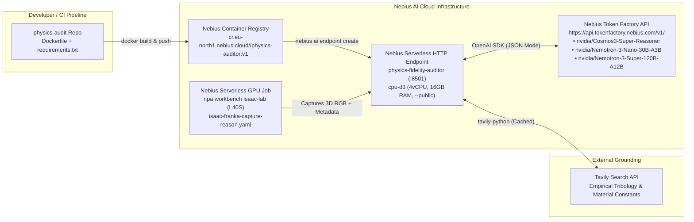

# Physical Fidelity Auditor (`physics-audit`) — High-Level & Detailed Workflow Architecture

[](#)
[](https://api.tokenfactory.nebius.com/v1/)
[](#)
[](#)
[](#)

---

## 1. Executive Architecture Overview

**Physical Fidelity Auditor (`physics-audit`)** is a four-tier automated physical consistency benchmark and diagnostic platform built on **Nebius AI Cloud** and **Nebius Token Factory**. It evaluates whether generative 3D world models respect fundamental Newtonian mechanics—isolating **contact interpenetration**, **frictional grasp failure**, **ungrounded levitation**, **momentum/energy non-conservation**, and **object permanence loss** before policies are transferred from simulation to real robots.



---

## 2. Detailed End-to-End Sequence Workflow

The following sequence diagram traces a complete execution cycle across **Isaac Lab**, **Nebius Token Factory (`Cosmos3-Super-Reasoner`)**, **Tavily Search API**, **Nebius Token Factory (`Nemotron-3-Nano-30B-A3B`)**, and the **Streamlit 3D Studio**.



---

## 3. Tier-by-Tier Technical Architecture & Data Contracts

### 3.1 Tier 1: 3D Ground Truth Generation (`ground_truth/`)

* **Primary Files:**
  * [`ground_truth/scenarios.py`](../ground_truth/scenarios.py) — Deterministic 3D rigid-body & articulated manipulation physics engine + software ray-traced PNG renderer.
  * [`ground_truth/capture_isaac_lab_scene_frames.py`](../ground_truth/capture_isaac_lab_scene_frames.py) — CLI and SDK entrypoint for capturing `Isaac-Lift-Cube-Franka-v0` 5-stage manipulation keyframes (`approach`, `pre-grasp`, `grasp`, `lift`, `hold`).
  * [`ground_truth/run_isaac_lab.sh`](../ground_truth/run_isaac_lab.sh) — Shell wrapper for `npa workbench isaac-lab` serverless GPU jobs.

* **Supported 3D Benchmark Tasks:**

| Scenario Key | Isaac Lab Task ID | Physical System & Mass | Key Physical Constraints Tested |
| :--- | :--- | :--- | :--- |
| `franka_lift_cube` | `Isaac-Lift-Cube-Franka-v0` | 7-DOF Franka Panda arm + $0.10\text{ kg}$ ABS cube ($\mu_s = 0.65$) | Antipodal force-closure ($F_n \ge \frac{mg}{2\mu_s} = 0.755\text{ N}$), table SDF non-penetration, object permanence |
| `warehouse_amr` | `Isaac-Warehouse-AMR-Nav-v0` | $45.0\text{ kg}$ Differential-drive AMR + Forklift + Racks ($\mu_s = 0.72$) | Obstacle SDF clearance, floor plane constraint ($z = 0.23\text{ m}$), velocity/momentum smoothness |
| `block_stack` | `Isaac-Stack-Block-3D-v0` | $2.5\text{ kg}$ cantilevered wooden block ($\Delta x = 0.34\text{ m} > 0.25\text{ m}$ support) | Gravitational torque toppling ($\tau = r \times mg$), pedestal & floor non-penetration |
| `projectile` | `Isaac-Projectile-3D-v0` | $0.8\text{ kg}$ steel sphere launched at $6.8\text{ m/s}$ ($52^\circ$ elev, $18^\circ$ azim, $e = 0.68$) | 3D ballistic parabola ($\ddot{z} = -g$), coefficient of restitution energy decay ($E_{k}^{+} \le e^2 E_{k}^{-}$) |
| `ramp_roll` | `Isaac-Ramp-Roll-3D-v0` | $1.0\text{ kg}$ rubber sphere on $25^\circ$ inclined wooden plane ($\mu_s = 0.50$) | Inclined plane acceleration ($a = \frac{5}{7}g\sin\theta$), ramp surface SDF constraint |

* **Output Data Contract (`data/ground_truth/<scenario>/metadata.json`):**
```json
{
  "task": "Isaac-Lift-Cube-Franka-v0",
  "scenario": "franka_lift",
  "mass": 0.1,
  "object_mass": 0.1,
  "friction": 0.65,
  "friction_coefficient": 0.65,
  "restitution": 0.15,
  "num_frames": 25,
  "stages": ["approach", "pre-grasp", "grasp", "lift", "hold"]
}
```

---

### 3.2 Tier 2: 3D World Model & Scene Reasoning (`npa/` & `world_model/`)

* **Primary Files:**
  * [`npa/workbench/token_factory.py`](../npa/workbench/token_factory.py) — Core implementation of `reason_scene()` communicating with `nvidia/Cosmos3-Super-Reasoner` on Nebius Token Factory.
  * [`npa/cli.py`](../npa/cli.py) — Implements `npa workbench cosmos token-factory reason`.
  * [`npa/examples/isaac_franka_token_factory_reason.py`](../npa/examples/isaac_franka_token_factory_reason.py) — Standalone validation script for sample and custom Franka frames.
  * [`world_model/predictor.py`](../world_model/predictor.py) — Generates full 3D predicted trajectories and rendered frames across three controlled evaluation profiles:
    1. `cosmos_default`: Injects realistic world-model physics hallucinations (table SDF interpenetration, zero-force magnetic levitation, energy spikes, and frame drop flicker).
    2. `physically_solvent`: High-fidelity physical prediction ($\text{PHR} < 0.05$, $\text{PIR} > 0.90$, Grade `A`).
    3. `severe_hallucination`: Extreme stress-test profile ($\text{PHR} > 0.45$, Grade `F`).

* **Output Data Contract (`data/predictions/franka_lift/scene_reasoning.json`):**
```json
{
  "status": "completed",
  "model": "nvidia/Cosmos3-Super-Reasoner",
  "task": "Isaac-Lift-Cube-Franka-v0",
  "scene_description": "A 7-DOF Franka Emika Panda robotic manipulator mounted on an optical worktable interacts with a 0.10 kg red target cube...",
  "manipulation_plan": [
    {
      "step": 0,
      "stage": "approach",
      "frame_range": [0, 4],
      "predicted_ee_z_m": 0.52,
      "predicted_cube_z_m": 0.04,
      "predicted_grasp_force_n": 0.0,
      "predicted_sdf_clearance_m": 0.18,
      "object_visible": true
    },
    {
      "step": 1,
      "stage": "pre-grasp",
      "frame_range": [5, 9],
      "predicted_ee_z_m": -0.095,
      "predicted_cube_z_m": -0.095,
      "predicted_grasp_force_n": 0.0,
      "predicted_sdf_clearance_m": -0.133,
      "object_visible": true
    }
  ]
}
```

---

### 3.3 Tier 3: Automated Physics Judge (`auditor/`)

* **Primary Files:**
  * [`auditor/tavily_client.py`](../auditor/tavily_client.py) — Queries Tavily Search API for real-world material friction ($\mu_s$) and restitution ($e$) ranges, caching results in `data/cache/tavily_cache.json`.
  * [`auditor/prompt_templates.py`](../auditor/prompt_templates.py) — Constructs structured system and user prompts for both trajectory-level audits (`build_audit_prompt`) and Cosmos manipulation-plan audits (`build_plan_audit_prompt`).
  * [`auditor/nemotron_client.py`](../auditor/nemotron_client.py) — Calls `nvidia/Nemotron-3-Nano-30B-A3B` on `https://api.tokenfactory.nebius.com/v1/` with `response_format={"type": "json_object"}`, strips `<think>...</think>` reasoning blocks, validates JSON via Pydantic, and supports escalation to `nvidia/Nemotron-3-Super-120B-A12B`.
  * [`auditor/schemas.py`](../auditor/schemas.py) — Defines `ViolationItem`, `AuditReport`, `compute_sipa_metrics()`, and `classify_pir_rubric()`.

#### Five Physical Law Evaluators
1. **`contact_constraint`:** Checks signed distance field clearance $\text{SDF}(t) \ge 0\text{ m}$ between the manipulated object, robot links, worktable, and floor. Any $\text{SDF}(t) < -0.015\text{ m}$ is flagged as solid-body interpenetration (`HIGH` severity).
2. **`friction_slipping`:** Verifies antipodal grasp force closure against the Tavily-grounded static friction coefficient $\mu_s$:
   $$F_{\text{grasp}}(t) \ge F_{\text{min}} = \frac{m g}{2 \mu_s}$$
   For the $0.10\text{ kg}$ cube with $\mu_s = 0.65$, lifting requires $F_{\text{grasp}} \ge 0.755\text{ N}$.
3. **`gravity_support`:** Checks that any object ascending ($\dot{z} > 0$) or suspended above its support surface ($z > z_{\text{table}}$) has active physical support or grasp force closure.
4. **`momentum_conservation`:** Detects uncommanded velocity jumps ($\|\Delta \mathbf{v}\| / \Delta t > a_{\max}$) and mechanical energy creation ($E_{\text{pred}}(t) > E_{\text{GT}}(t) + \epsilon_E$).
5. **`object_permanence`:** Verifies continuous object visibility ($\text{visible}(t) = \text{True}$) and bounding-box persistence across all frames.

#### SIPA Mathematical Formulation & PIR Grading Rubric
* **Physics Hallucination Rate ($\text{PHR}$):**
  $$\text{PHR} = \frac{|\{\text{violated steps or frames}\}|}{N_{\text{total}}} \in [0.0, 1.0]$$
* **Physical Integrity Rating ($\text{PIR}$):**
  $$\text{PIR} = \text{clip}_{[0,1]}\!\left(0.45(1 - \text{PHR}) + 0.25(1 - D_{\text{sev}}) + 0.15\,\text{TCS} + 0.15(1 - P_{\text{debt}})\right)$$

| PIR Score Range | Grade | Label | Operational Meaning |
| :--- | :---: | :--- | :--- |
| **`0.70 – 1.00`** | **`A`** | **`Physically Solvent`** | Model respects conservation laws and contact mechanics; safe for sim-to-real policy evaluation. |
| **`0.30 – 0.69`** | **`C`** | **`Moderate Risk`** | Measurable physical debt; policy may fail under contact-rich edge cases. |
| **`0.00 – 0.29`** | **`F`** | **`Critical`** | Physical bankruptcy; trajectory violates fundamental causality. |

---

### 3.4 Tier 4: Interactive 3D Simulation & Audit Studio (`dashboard/` & Nebius Serverless Endpoint)

* **Primary Files:**
  * [`dashboard/app.py`](../dashboard/app.py) — Full-bleed NVIDIA Omniverse / Isaac Sim dark-mode 3D Simulation Studio UI (`http://localhost:8501`) featuring:
    * **Left Scene Hierarchy Panel:** Interactive tree (`Warehouse`, `Environment`, `Racks`, `Robots`, `Objects`, `Sensors`) with visibility toggles.
    * **Center 3D Perspective Viewport (`RTX - Real Time`):** Renders the 3D warehouse/manipulation scene, dynamic LiDAR ray fan, spline navigation path, 3D bounding boxes, and real-time **Cosmos Dream (Hallucinate)** vs. **Isaac Lab GT** comparison overlay.
    * **Right Robot Inspector:** Live 3D Transform (`Position X/Y/Z`, `Rotation Roll/Pitch/Yaw`, `Scale`), Battery/Speed/State telemetry, 2D Top-Down Occupancy Minimap, and **SIPA Physics Audit Score Card**.
    * **Bottom Multi-Sensor Dock & Nebius Audit Drawer:** Live `Lidar_01` point-cloud sweep, `Camera_Front`, `Camera_Rear`, CPU/GPU/FPS metrics, and an expandable **Nebius Token Factory + Tavily Physics Audit Console** with one-click live auditing.
  * [`Dockerfile`](../Dockerfile), [`nebius_jobs/deploy_endpoint.sh`](../nebius_jobs/deploy_endpoint.sh), [`nebius_jobs/deploy_endpoint.ps1`](../nebius_jobs/deploy_endpoint.ps1) — Containerizes and deploys the studio as a managed HTTPS service on Nebius AI Cloud (`nebius ai endpoint create --container-port 8501 --platform cpu-d3 --preset 4vcpu-16gb --public`).

---

## 4. Deployment & Infrastructure Topology on Nebius AI Cloud


